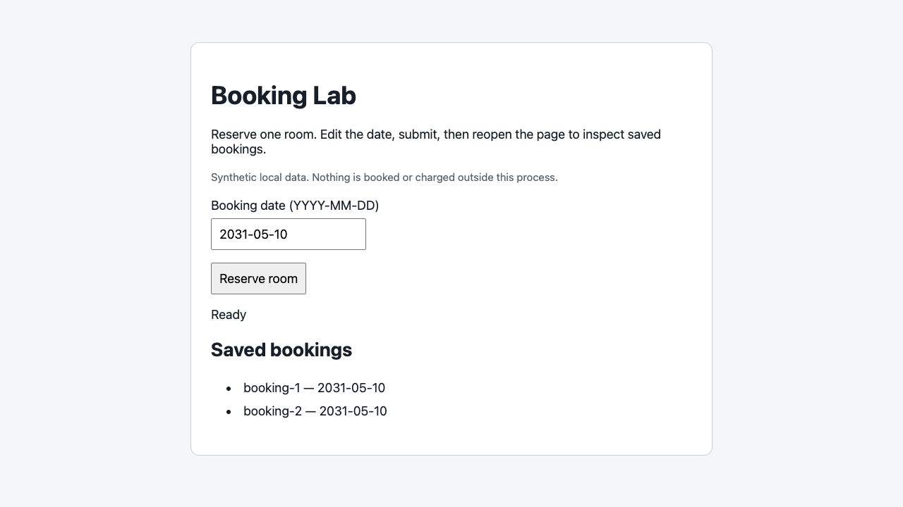
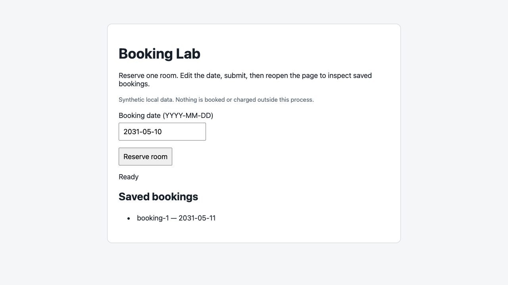

# Outcome QA

## Give your coding agent a senior QA playbook.

The booking screen said **Confirmed**. After a reload, there were two reservations. Both used the original date, not the one the customer picked.

A good QA engineer doesn't stop at the confirmation. They know what the product owes the user, what could go wrong, and which check is worth doing next. **Outcome QA gives your coding agent that way of working**: investigate the feature, follow the evidence, and hand back a result a teammate can act on.

Use it for **web apps, APIs, integrations, automated tests, AI features, and security boundaries**. Start with a ticket, a feature to explore, a failing test, or a fix to verify.

[Quickstart](#quickstart) · [What it does](#how-it-works) · [See the demo](docs/DEMO.md)

## Quickstart

Run this from the project you want to test:

```sh
npx skills add c33leron/outcome-qa
```

Choose your skills and agent in the installer. It supports **Codex, Claude Code, Cursor, OpenCode, GitHub Copilot, Gemini CLI, Antigravity, Hermes Agent** and [more](https://github.com/vercel-labs/skills/blob/main/docs/agents.md). Requires Node.js 22.20+ and Git. Install is per project by default; add `-g` to install for your user.

Start a fresh session in your project. Give the agent a feature, its requirements, and the environment it may use:

> Test this booking flow against the acceptance criteria on staging. Focus on what could leave the customer with the wrong reservation. Show me what you actually checked, what broke, and how to reproduce it.

You don't need to write a QA prompt from scratch. [Other ways to install](docs/INSTALL.md): clone and copy, the optional full Codex or Claude Code plugin, or a Markdown playbook for assistants without skill discovery.

## How it works

**Work out what matters first.** Start with the acceptance criteria, the user's goal, and the current state. If the ticket is unclear about something that would change the verdict, surface it. Spend time on risks that can lose work, duplicate an action, corrupt data, or break a critical path—not on generating the longest checklist.

**Use the product like a person.** A customer edits a value after seeing the preview. Clicks twice when nothing happens. Loses the connection and returns. The agent starts with a normal journey and chooses which interruption, retry, or permission change makes sense for this feature.

**Let the result drive the next check.** A bad value on screen might come from the form, the API, or a downstream worker. The agent follows the relevant part of that path and checks the intended effect as well as what should stay unchanged. It can switch from browser exploration to a contract check or AI-quality investigation without treating every task as a full-stack audit.

**Hand back something useful.** Get a reproducible finding with expected vs. observed behavior, evidence, and the affected scope. A broken fixture is not a product bug. A missing credential is not a pass. For a claimed fix, return to the original reproduction and check what the repair might have broken nearby.

### What that changes in practice

| Situation | The follow-up that matters |
|---|---|
| A booking confirmation looks right. | After correcting the date and repeating the same submission, reload and check the reservation count and saved date. |
| An API responds `202 Accepted`. | Follow the job to its final state. Did the export complete, and can the user actually open the file? |
| An AI acknowledges a correction. | Compare the source facts, raw response, and final report. Did the correction make it through, and did unrelated facts survive? |
| A write from the wrong account returns `403`. | Read the record as its owner. The rejected request must not have changed it. |
| CI is green. | Try a known broken result. If the assertion never ran, green tells you nothing about the behavior it was meant to protect. |

In the [recorded booking demo](docs/DEMO.md), the same browser journey left **two reservations on the old date** in the faulty fixture and **one on the corrected date** in the healthy control. The demo includes captured browser states and independent API read-back.

| Faulty build: two bookings on the original date | Healthy control: one booking on the corrected date |
|---|---|
|  |  |

### Seven methods. Use only what the task needs.

| Task | Skill |
|---|---|
| Turn a requirement or contract into test cases | `oq-test-design` |
| Explore a feature, API, or end-to-end journey | `oq-explore` |
| Write, repair, or review automated tests | `oq-automation` |
| Check AI answers, corrections, and downstream effects | `oq-ai-quality` |
| Find false passes in assertions, judges, or gates | `oq-checker-audit` |
| Verify a fix against the original failure | `oq-retest` |
| Test access, sessions, inputs, and AI action boundaries | `oq-security-journeys` |

For an open-ended test, Explore leads and brings in other methods when the evidence calls for them. Optional plugin reviewers can challenge a finding or a test without rerunning the product. The host supplies the model, tools, and permissions; the kit doesn't start a background service or bundle a browser. The one-command install copies only the skills, not the tests, labs, or evaluation fixtures.

[Verification](docs/VERIFICATION.md) · [Support](SUPPORT.md) · [MIT License](LICENSE) · [Third-party notices](THIRD_PARTY_NOTICES.md)
