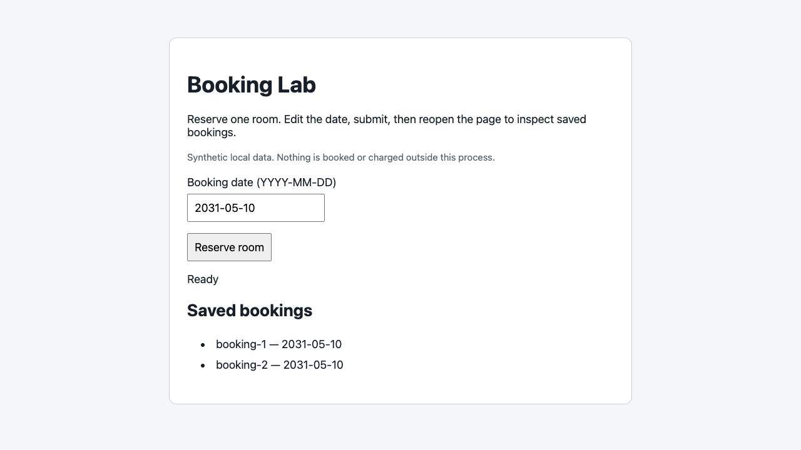
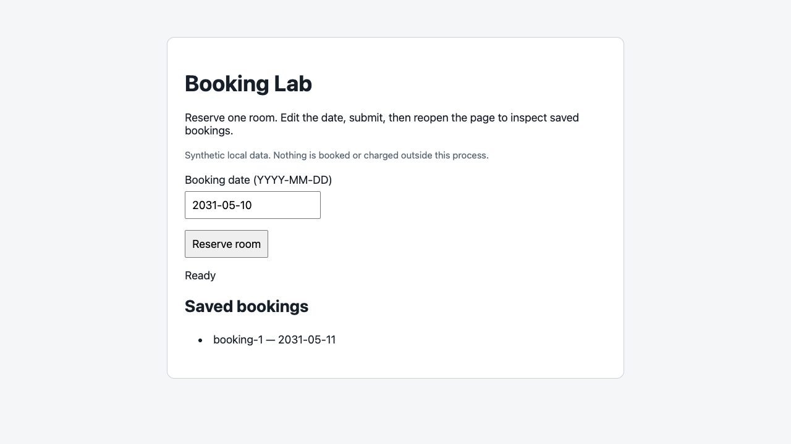

# Demonstrations: what they establish

Three different checks are available. None proves comparative agent quality or guarantees a bug in a healthy product.

## 1. Actual local booking journey

```sh
python3 scripts/demo_app.py --variant buggy --port 0
```

Open the printed loopback URL with a real browser and use `evals/booking-task.md`. Enter/correct a date, submit, repeat the relevant action and reload. Independently read saved state. Repeat with a fresh `--variant fixed` process and the same task. The server uses in-memory synthetic data; token/origin/host guards protect state changes. CLI probes fetch the session capability into memory and do not print or persist it. Stop the server afterward.

A browser test of these disclosed fixtures is an informed smoke unless the fault labels/source were withheld. Correct frontend actions must not be substituted with API setup and called UI coverage.

## 2. Denied write with owner read-back

```sh
python3 scripts/boundary_lab.py --variant buggy --port 0
```

Use `evals/boundary-task.md`, then compare with a fresh fixed variant. Both deny the non-owner write with 403; independent owner state distinguishes a preserved object from a write performed before rejection. Both use synthetic actors and canaries, not real accounts or leaked data.

## 3. Ten paired state-replay controls

```sh
python3 scripts/demo_cases.py --format text
```

This executes the local state-contract helper against ten healthy/corrupted-or-insufficient snapshot pairs: saved date, duplicate effect, denied-write mutation, collateral edit, stale intent, post-cancel effect, normalized negative fact, fact ownership, partial completion and wrong entity.

These are **ten replay cases, not ten applications and not ten bugs found by an AI**. The fact cases already have adjudicated structured values; they do not measure understanding of natural language. The wrong-entity case must be INCOMPLETE rather than falsely declaring a product bug. Unit tests ensure fixture distinctions remain reachable.

## Recording a public demonstration

Use clean captured UI frames and synthetic data. A screenshot/GIF shows the actual captured states; it is not a substitute for request/read-back evidence. Keep fault labels away from an agent during a claimed blind run, preserve all attempts and show a healthy control. Record environment, tool/version, initial state, selected skill and cleanup.

Onboarding metric: elapsed setup → first valid observed check. Record failures and the clock boundary; do not promise “first bug in five minutes.” Publishing a recording, evidence or repository remains a separate deliberate step. Private raw traces stay outside the release.

## Recorded synthetic demo — 2026-11-10

A fresh Codex CLI 0.164.0 process explicitly loaded the candidate runtime methods and used the installed Playwright CLI with isolated browser sessions. It corrected the date to 2031-05-11, confirmed twice, reloaded and independently read the saved bookings. The faulty variant retained two bookings on 2031-05-10. The healthy variant retained one on 2031-05-11 and also passed a separate ordinary submission control.





These are actual captured, visually inspected UI states—not reconstructed images. The date input resets to its default on reload; the **Saved bookings** list is the persisted state being compared. There are no automation overlays in the captures.

Both booking labs were reset and independently read back as empty. Browser sessions and all lab servers were closed. The API-only boundary checks are separate from this browser coverage. An initial wrong-method API attempt was retained as a harness error, not counted as a product failure. See [Verification](VERIFICATION.md) for the separate release-package checks.

This was an informed synthetic-fixture smoke with existing tools and authentication, not a clean-machine onboarding measurement, an unseen benchmark or evidence of superiority over another QA kit. No timing or universal detection promise is made.
